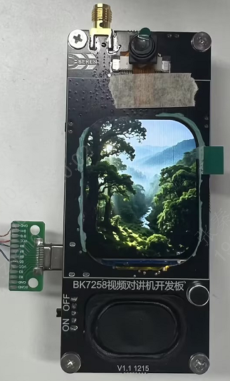

# lcd spi屏显示jpeg图片

| 支持的芯片 | BK7258 |
| --------- |  ------- |

[TOC]  

## 相关章节
 - [官网lcd示例](https://docs.bekencorp.com/arminodoc/bk_avdk_smp/ap_doc/bk7258/zh_CN/v3.1.1/developer-guide/display/spi_lcd_display.html)
 - [bk_vfs文件系统](/storage/internal_flash_littlefs/README.md)
 - [jpeg硬解输出yuv](/peripherals/jpeg/hardware_decode/decode_jpg_to_yuv422/README.md)
 - [jpeg硬解输出rgb565小端](/peripherals/jpeg/hardware_decode/decode_jpg_to_rgb565_little_endian/README.md)
 - [jpeg硬解输出rgb565大端](/peripherals/jpeg/hardware_decode/decode_jpg_to_rgb565_big_endian/README.md)

## 概述

BK7258 能够使用通用的**QSPI（single模式，兼容SPI，速率更高，实际使用时推荐）/SPI外设**刷新屏幕， 但需要严格按照屏幕的相关技术参数要求操作，由于各家屏厂的技术参数一般有差异性，建议使用前对屏幕的相关技术资料进行仔细阅读。

本示例是将**内部flash的user_config分区**作为littlefs分区，结合sample_project/components下的hw_jpeg_decode模块，实现以下功能：
1. 自己的SPI屏驱怎么写；
2. 如何挂载文件系统；
3. 如何打开lcd；
4. 如何显示jpeg图片；

> **备注** ：jpeg图片及解码后的内存申请和释放，是调用frame_buffer_app.c中的函数，默认是从frame_buffer内存分配，如果psram内存调整为所有都作为堆内存(**[多媒体相关的几个PSRAM大小都配置为0](https://docs.bekencorp.com/arminodoc/bk_avdk_smp/ap_doc/bk7258/zh_CN/v3.1.1/developer-guide/peripheral/bk_psram.html?highlight=psram#id8)**)，可以将frame_buffer_app.c里的USE_PSRAM_MALLOC配置为1，即从psram堆分配内存。

## 硬件环境

- 核心板：BK7258视频对讲机开发板 V1.1 (BK7258QN6855封装，4MB SiP Flash，4MB SiP PSRAM)
- 显示屏：jd9853a 240X296 QSPI屏幕

> **备注** ：如果更换为其它屏幕，需修改dev_lcd.c中的屏幕参数: spi_config里的屏的lcd_device、spi_id，相关io管脚：ldo、背光、复位、SCK、CS、SDA、RS（命令-0、数据-1）；



## 相关配置

以下配置在AP核，可通过 [menuconfig](https://gitlab.bekencorp.com/armino/release_sdk_sample/smp/sample_project#4配置修改) 进行配置。

| 配置名                    | 说明                               |
| -------------------- | ------------------------------------------ |
| CONFIG_VFS          | bk_vfs使能配置，配置为y                                         |
| CONFIG_VFS_MAX_FD_NUM    | bk_vfs同时打开文件的最大个数，如32         |
| CONFIG_LITTLEFS | littlefs使能配置，配置为y |
| CONFIG_JPEG_DECODER          | jpeg硬解码使能配置，配置为y                                         |
| CONFIG_JPEG_DECODER_HW    | jpeg硬解码使能配置，配置为y         |
| CONFIG_JPEGENC_HW | jpeg硬编码使能配置，硬解码有接口依赖，配置为y |
| CONFIG_DMA2D | bk7258 jpeg硬解码只能输出yuyv格式，如果需要通过dma2d将yuyv格式数据转换为rgb565格式，需要配置为y |
| CONFIG_QSPI | qspi 使能配置，需要配置为y |
| CONFIG_LCD_SPI | spi lcd 使能配置，需要配置为y |
| CONFIG_LCD_SPI_REFRESH_WITH_QSPI | spi lcd 使用QSPI硬件外设刷新使能配置，需要配置为y |
| CONFIG_LCD_SPI_REFRESH_WITH_QSPI_MAPPING_MODE | spi lcd 使用QSPI硬件外设映射模式使能配置，需要配置为y |

> **备注** ： 由于QSPI硬件single模式兼容普通SPI模式，而QSPI时钟频率最大支持80MHZ，SPI只支持40MHZ，因此实际使用时一般推荐使用QSPI硬件外设实现。

## 依赖模块

- sample_project/components/app_jpeg_hw_decode

**根目录下的 CMakeLists.txt** 中需要添加以下内容（放入自己工程需留意自己工程相对components的路径）：

``` cmake
set(EXTRA_COMPONENTS_DIRS
    ${CMAKE_CURRENT_SOURCE_DIR}/../../../../components/app_jpeg_hw_decode
)
```
**ap/CMakeLists.txt** PRIV_REQUIRES中需加入app_jpeg_hw_decode依赖，这样可直接调用这两个模块头文件：

``` cmake
set(priv_req  media_service multimedia bk_network_provisioning bk_jpeg_decoder app_jpeg_hw_decode)

armino_component_register(SRCS "${srcs}" INCLUDE_DIRS "${incs}" PRIV_REQUIRES "${priv_req}")
```

## 屏驱如何添加

> **备注** ：工程下面的lcd_qspi_jd9853a_app.c，是将sdk的jd9853a屏驱代码，复制到应用工程里；

- 先在SDK找到和自己屏驱类似的屏（**[SDK已支持的LCD型号及分辨率](https://docs.bekencorp.com/arminodoc/bk_avdk_smp/ap_doc/bk7258/zh_CN/v3.1.1/developer-guide/multimedia/peripherals.html#lcd)**），所有已支持的lcd屏的驱动都在sdk这个目录下：bk_avdk_smp/ap/components/bk_peripheral/src/lcd，复制对应相似的驱动到应用工程里；
- 参考 **[LCD设备驱动添加指南](https://docs.bekencorp.com/arminodoc/bk_avdk_smp/ap_doc/bk7258/zh_CN/v3.1.1/developer-guide/display/lcd_devices.html)**，修改lcd驱动；

## 操作说明
### 编译

运行以下命令进行编译构建

``` Shell
cd sample_project/peripherals/lcd/spi/display_jpg
vim Makefile  //修改SDK_DIR为实际smp sdk路径
make clean
make bk7258
```

### 操作方法及日志

- 参考[如何烧录](/BURN.md)，烧录工程build下的all-app.bin；
- sample_project/tools/littlefs/bk.bin烧录到user_config分区，即0x00242000地址；
- 上电后，lcd屏上会显示图片；

以下是上电运行后的关键串口log 输出：

```
[2026:01:07-16:07:05:263] ap0:OS:D(881):create spi_disp_thread, tcb=60319540, stack=[60318d18-60319518:2048], prio=3, xCoreID=-1   //打开lcd屏
[2026:01:06-17:53:19:040] ap0:hw_img:I(873):[2026:01:07-16:07:05:351] ap0:hw_img:I(929):[jpeg_hw_decode_from_file_to_rgb565][504] decode /littlefs/img/yuv422/example_256x296.jpg success, width:240, height:296, length:142080   //解码图片
```

## 常见问题

### 屏没显示

- 确认屏相关管脚是否正确；
- 用逻辑分析仪抓取spi初始化序列，确认数据是否正确；

## 故障排除

如有任何技术疑问，请联系我们FAE支持，或者在博通集成技术论坛上提交一个[问题](https://armino.bekencorp.com/)。我们会尽快回复您。
