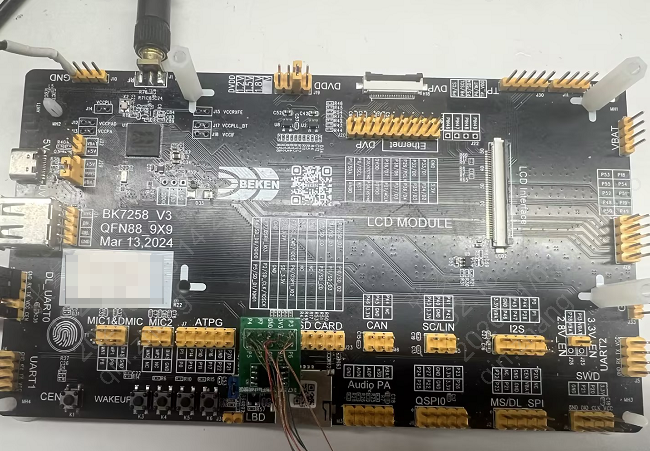

# QSPI Flash（标准模式） 测试示例

| 支持的芯片 | BK7258 |
| --------- | ------- |

[TOC]  

## 相关章节
 - [QSPI API参考](https://docs.bekencorp.com/arminodoc/bk_avdk_smp/ap_doc/bk7258/zh_CN/v3.1.1/examples/peripheral/bk_qspi.html)

## 概述

本示例实现了 QSPI Flash（**标准模式**）  的基本操作测试，包括擦除、写入、读取和数据验证功能。通过将 5000 字节的测试数据分块（256 字节/块）写入 QSPI Flash，然后读取并验证数据的正确性，展示了 QSPI Flash 的基本使用方法。

## 测试功能描述

1. **QSPI Flash 初始化**：初始化 QSPI Flash 接口
2. **数据准备**：生成 5000 字节的测试数据
3. **块擦除**：擦除指定区域的 QSPI Flash 存储
4. **分块写入**：将 5000 字节数据分块（256 字节/块）写入 QSPI Flash
5. **分块读取**：从 QSPI Flash 分块读取 5000 字节数据
6. **数据验证**：比较写入和读取的数据，验证操作的正确性

## 相关配置

以下配置在 AP 核，可通过 [menuconfig](https://gitlab.bekencorp.com/armino/release_sdk_sample/smp/sample_project#4配置修改) 进行配置：

| 配置名        | 说明                               |
| ------------- | ---------------------------------- |
| CONFIG_QSPI    | QSPI 外设使能配置，配置为 y         |
| CONFIG_QSPI_MST_FLASH | QSPI Flash 主模式使能配置，配置为 y |
| CONFIG_QSPI_LINE_MODE | QSPI Flash 线模式配置，配置为 2(标准模式) |

## 硬件环境

- 核心板：BK7258 开发板
- QSPI Flash：外挂 QSPI Flash 存储芯片




## 测试参数

| 参数名            | 数值          | 说明                      |
| ----------------- | ------------- | ------------------------- |
| TEST_FLASH_ADDR   | 0x0      | 测试起始地址              |
| TEST_UNIT_SIZE    | 256           | 操作单元大小（字节）      |
| TOTAL_TEST_SIZE   | 5000          | 总测试数据大小（字节）    |
| NUM_OPERATIONS    | 20            | 分块操作次数              |

## 代码结构

```
├── ap/
│   ├── ap_main.c       # 主程序，实现 QSPI Flash 测试逻辑
│   └── CMakeLists.txt  # 编译配置
└── README.md           # 项目文档
```

## 测试流程

1. **初始化**：调用 `bk_qspi_flash_init` 初始化 QSPI Flash 接口
2. **数据准备**：生成包含递增数值的测试数据
3. **擦除操作**：使用 `bk_qspi_flash_erase` 擦除目标区域
4. **写入操作**：循环调用 `bk_qspi_flash_single_page_program` 将数据分块写入
5. **读取操作**：循环调用 `bk_qspi_flash_single_read` 将数据分块读取
6. **验证操作**：比较写入和读取的数据是否一致

## 编译和运行说明

### 编译

运行以下命令进行编译构建：

``` Shell
cd sample_project/peripherals/qspi_flash/standard
vim Makefile  # 修改 SDK_DIR 为实际 smp sdk 路径
make clean
make bk7258
```

### 运行

1. 参考 [如何烧录](/BURN.md)，烧录工程 build 下的 all-app.bin
2. 上电后，系统会自动运行 QSPI Flash 测试程序

## 日志示例

以下是程序运行后的关键串口日志输出：

```
[2026:01:09-18:08:59:732] ap0:main:I(653):[app_qspi_flash_test][73] QSPI flash driver init success, QSPI ID: 1  // 驱动初始化成功
[2026:01:09-18:08:59:739] ap0:main:I(653):[app_qspi_flash_test][77] Flash ID: 0x1840ef //  确认 Flash ID 与预期值一致，注意大小端

[2026:01:09-18:09:00:565] ap0:main:I(1260):[app_qspi_flash_test][151] Flash test PASS: All write and read data match!  // 确认数据验证通过
```

## 常见问题

### 测试失败

- 确认硬件是否正确（包括引脚连接、电源电压）
- 确认 QSPI Flash 地址是否有效
- 确认目标区域是否已擦除
- 检查 QSPI Flash 初始化是否成功

### 数据验证失败

- 确认写入和读取的地址范围一致
- 检查分块操作的边界处理
- 验证 QSPI Flash 的擦除、写入和读取操作是否正确执行

## 故障排除

如有任何技术疑问，请联系我们FAE支持，或者在博通集成技术论坛上提交一个[问题](https://armino.bekencorp.com/)。我们会尽快回复您。
